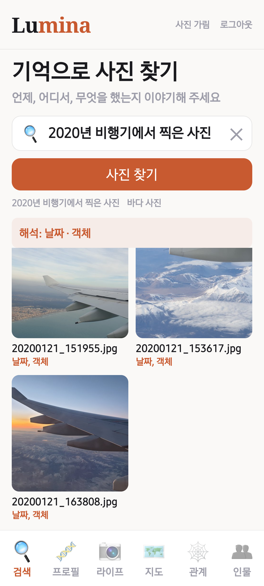

# Lumina

Lumina는 자연어로 휴대폰 갤러리의 사진을 찾는 Android 앱입니다. 사진에 담긴 인물, 객체, 활동과 촬영 정보를 미리 분석하고, 사용자의 질문을 검색 조건으로 바꿔 관련 사진을 보여줍니다.

예를 들어 “2020년 비행기에서 찍은 사진”을 입력하면 2020년이라는 날짜 범위와 비행기라는 객체 조건을 함께 적용합니다.

## 주요 기능

- **자연어 검색**: 날짜, 장소, 인물, 객체와 활동을 조합한 질문으로 사진을 찾습니다.
- **인물별 사진 정리**: 얼굴을 검출하고 임베딩을 비교해 같은 인물이 등장하는 사진을 묶습니다.
- **사진 내용 분석**: 객체와 속성, 활동, 인물의 등장 패턴을 구조화합니다.
- **분석 결과 조회**: 인물, 라이프, 프로필과 관계 화면에서 저장된 결과를 확인합니다.

## 검색 화면



2026년 9월 29일 복구 앱의 Android 실기기에서 촬영한 화면입니다. 저장소에는 Gemini 기반 원본 구현을 수록했습니다.

## 소스 구성

```text
mobile/           React Native와 Expo 앱, Android 소스, 앱 아이콘
backend/          Flask API, 사진 업로드와 조회, Gemini 검색
ai_server/        작업 큐, SFTP 전송, 파이프라인 실행과 진행률 관리
ai_pipeline/      얼굴 검출과 군집화, 인물 및 관계 분석, 라이프스타일 분석
time_prediction/  데이터 준비, Qwen 특징 추출, 학습, 추론, 평가와 웹 추론 서버
dataset_tools/    시간 단서 필터링과 임베딩 군집 기반 데이터 선별
experiments/      출력과 인증 정보를 제거한 데이터 병합 및 레이어 실험 노트북
```

`time_prediction/`은 기존 `image_time_prediction` 저장소의 코드를 기준으로 구성했습니다. 데이터셋, 사진 원본, 얼굴 임베딩, 모델 가중치와 인증 파일은 포함하지 않습니다. 파이프라인에 압축해 넣었던 Python 코드는 개별 소스 파일로 분리했습니다.

## 실행 준비

Python 3.10 이상과 앱용 Node.js, Android SDK가 필요합니다. 얼굴 분석과 Qwen 특징 추출은 CUDA 환경을 기준으로 개발했습니다. 각 구성요소의 `requirements.txt`와 앱의 `package-lock.json`에 의존성을 정리했습니다.

1. 루트의 `.env.example`을 `.env`로 복사해 Google Cloud 프로젝트, 외부 서비스 계정 파일 경로, 서버 연결 정보를 입력합니다. 검색과 분석은 원본의 Gemini / Vertex AI 경로를 사용합니다. 선택적인 데이터 선별 도구의 Gemini API 키도 환경변수로만 받습니다.
2. API 서버는 루트에서 `python -m pip install -r backend/requirements.txt` 후 `python backend/app.py`로 실행합니다.
3. AI 서버에서는 `ai_server/requirements.txt`, `ai_pipeline/requirements.txt`, `time_prediction/requirements.txt`를 설치하고 `python ai_server/ai_server.py`를 실행합니다. SFTP 접속 대상과 경로를 설정하고, AdaFace 및 시간 예측 가중치는 별도로 준비해야 합니다. 같은 PC에서 파이프라인만 실행하려면 `python ai_pipeline/integrated_server.py --photo-root <사진폴더>`를 사용합니다.
4. 앱은 `mobile/.env.example`을 `mobile/.env`로 복사해 API 주소를 지정한 뒤, `mobile/`에서 `npm ci`, `npx expo prebuild --platform android --clean`, `npx expo run:android` 순서로 실행합니다. 서명 키, Firebase 설정과 Gradle 실행 바이너리는 포함하지 않으며 Android 프로젝트 생성 단계에서 로컬 개발 환경을 준비합니다. 원격 푸시를 사용할 때는 본인의 Expo/Firebase 설정이 필요합니다.

원본 프로토타입의 인증 흐름을 유지했으며 서버 기본 주소는 로컬로 지정했습니다. 인터넷에 공개할 때는 별도의 계정별 접근 제어와 HTTPS 구성이 필요합니다. 모델과 데이터는 각 배포처의 이용 조건을 확인해 준비해야 합니다.

## 시스템 구성

```text
Lumina 앱 (React Native / Expo)
    │
    ├─ 사진 분석 요청 ──> API 서버 ──> 작업 큐 / AI 처리 서버
    │                                      │
    │                               얼굴 및 장면 분석
    │                               인물 패턴과 관계 분석
    │                                      │
    │                               분석 결과 JSON 저장
    │                                      │
    └─ 자연어 검색 ─────> API 서버 <─────────┘
                            │
                      LLM으로 질문 해석
                      저장된 결과에서 후보 검색
                            │
                      사진 목록을 앱에 반환
```

사진 분석과 검색은 분리되어 있습니다. 얼굴 임베딩 추출과 장면 분석은 사진을 처리할 때 수행하고, 이후 검색에서는 저장된 결과를 재사용합니다.

### 사진 분석

1. 앱이 사진 분석을 요청하면 API 서버가 AI 처리 서버의 작업 큐로 전달합니다.
2. InsightFace로 얼굴을 검출하고 정렬합니다. AdaFace 임베딩을 비교해 인물별로 묶습니다.
3. 이미지별 객체, 속성, 활동과 주변 맥락을 추출합니다.
4. 여러 사진의 관찰과 등장 패턴을 종합하고, 사용자 기준 프로필을 활용해 인물 관계를 추론합니다.
5. 사진과 인물의 연결, 설명, 촬영 정보 등을 구조화된 데이터로 저장합니다.

얼굴 크롭에는 여백을 추가하고, 최초 검출의 랜드마크를 재사용해 중복 검출을 줄였습니다. 인물 관계는 사진에서 추론한 결과이므로 실제 관계와 다를 수 있습니다.

에이전트는 `ObserverAgent`의 이미지 관찰, `ReasonerAgent`의 패턴 종합, `SocialAnalystAgent`의 관계 분석으로 이어집니다. `PersonZeroProfiler`는 관계 해석에 필요한 사용자 기준 프로필을 제공합니다.

### 검색 처리

1. 앱이 사용자의 질문을 인증된 검색 API로 보냅니다.
2. LLM이 질문을 날짜 범위, 장소, 인물, 객체와 활동 조건으로 구조화합니다.
3. 서버가 저장된 촬영 정보와 분석 결과를 비교해 후보를 좁힙니다.
4. 결과 목록과 해석된 검색 조건을 앱에 반환합니다.
5. 앱은 연결 가능한 갤러리 사진을 표시하고, 필요하면 인증된 서버 이미지 경로를 사용합니다.

검색 조건에는 다음 필드가 사용됩니다.

| 필드 | 내용 |
|---|---|
| `date_range` | 시작일과 종료일 |
| `date_months` | 연도 없이 지정된 월 |
| `location` | 지명, 중심 좌표와 검색 반경 |
| `people` | 질문에 등장한 인물 이름 |
| `object_terms` | 객체와 속성을 찾기 위한 단어 |
| `activity_terms` | 활동을 찾기 위한 단어 |

“2020년 비행기에서 찍은 사진”은 2020년 날짜 범위와 비행기 관련 객체 단어로 해석됩니다. “찍은 사진”과 같은 요청 표현은 활동 조건에서 제외합니다.
